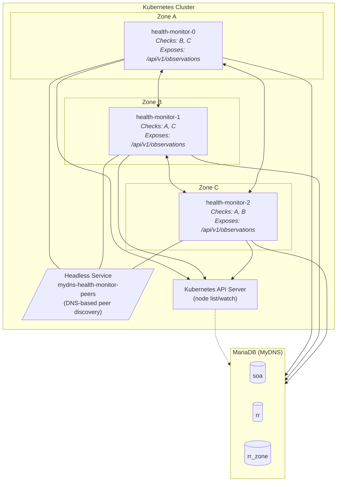
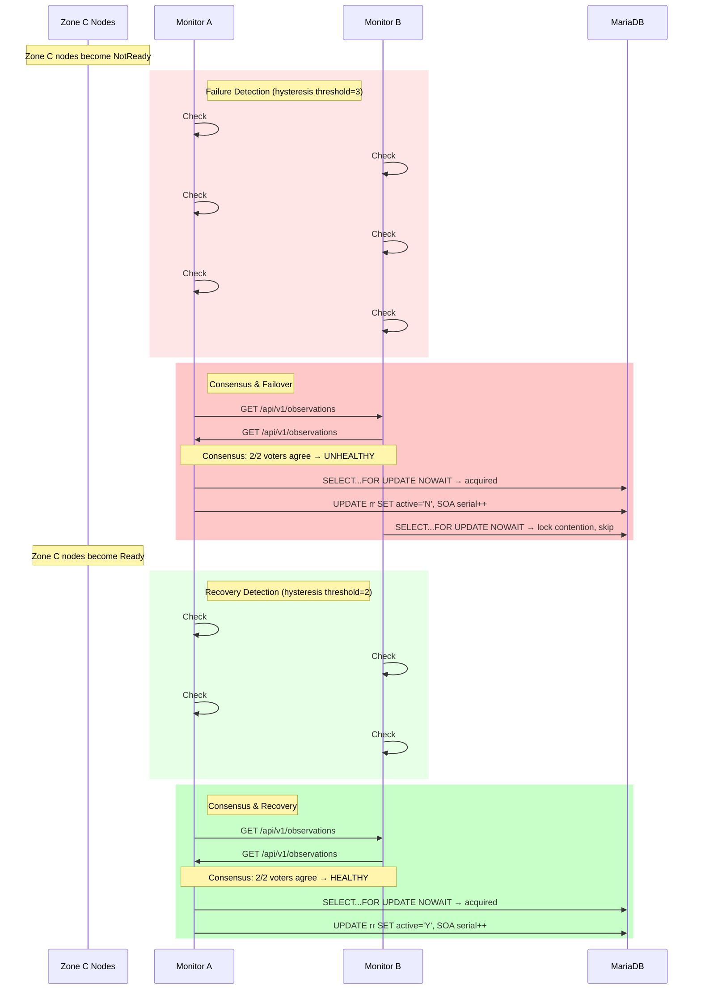
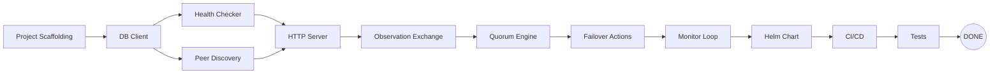

# Feature Plan: Zone Health Monitor for mydns-ng

## Document Control

| Version | Date | Author | Changes |
|---------|------|--------|---------|
| 0.1 | 2026-03-19 | AI Assistant | Initial draft |

## Summary

The Zone Health Monitor (`mydns-health-monitor`) is a Go-based Kubernetes service that detects geographic zone failures and automatically deactivates DNS records pointing to unreachable zones. It runs one pod per Kubernetes topology zone, discovers peers dynamically via headless Service DNS, and uses quorum-based consensus to prevent split-brain scenarios. When a majority of monitors agree a zone is unhealthy, the monitor sets `active='N'` on the affected records in the MyDNS `rr` table (identified via the `rr_zone` mapping table). When the zone recovers, records are gradually restored. No CRDs are used — monitors share observations via a lightweight HTTP API between peers.

---

## User Story

As a **DNS infrastructure operator**,
I want **automatic detection and deactivation of DNS records pointing to failed Kubernetes zones**,
So that **DNS queries never resolve to unreachable IPs when a geographic zone goes down**.

---

## Problem Statement

- **What problem does this solve?** When a Kubernetes zone (e.g., a geographic region) goes down, DNS records pointing to IPs in that zone remain active. DNS clients resolve to unreachable IPs, causing connection timeouts and service outages.
- **Who experiences this problem?** End users accessing services via DNS, and operators who must manually deactivate records during zone failures.
- **How is it handled today?** Manual intervention — an operator must log into the database and set `active='N'` on affected records. There is no automated detection or failover.

---

## Acceptance Criteria

### Core Health Checking
- [ ] Given a monitor pod running in zone A, when it starts, then it discovers all peer monitors via headless Service DNS lookup
- [ ] Given a monitor pod running in zone A, when it performs health checks, then it checks all OTHER zones but never its own zone
- [ ] Given a zone's nodes are all NotReady, when the monitor checks that zone, then it reports the zone as unhealthy

### Peer Discovery & Communication
- [ ] Given a new monitor pod joins, when existing monitors perform DNS lookup on the headless Service, then they discover the new peer automatically
- [ ] Given a monitor pod is removed, when peers perform DNS lookup, then the removed pod is no longer discovered
- [ ] Given a monitor has observations, when peers query its `/api/v1/observations` endpoint, then it returns its current health observations

### Quorum Consensus
- [ ] Given a monitor cannot reach ANY other monitor, when it evaluates consensus, then it takes NO action (isolation detection)
- [ ] Given >50% of non-self monitors report a zone as unhealthy, when consensus is evaluated, then the zone is marked for deactivation
- [ ] Given a zone has fewer consecutive failures than the failure threshold, when consensus is evaluated, then no action is taken (hysteresis)
- [ ] Given a zone has fewer consecutive successes than the success threshold after recovery, when consensus is evaluated, then records are not yet restored (hysteresis)

### Database Failover Actions
- [ ] Given consensus determines a zone is unhealthy, when the monitor deactivates records, then it uses `SELECT...FOR UPDATE NOWAIT` to prevent race conditions
- [ ] Given consensus determines a zone is unhealthy, when the monitor deactivates records, then it sets `active='N'` only on `rr` records mapped to that zone via `rr_zone`
- [ ] Given consensus determines a zone is unhealthy, when the monitor deactivates records, then it increments the SOA serial for affected DNS zones
- [ ] Given another monitor already deactivated the records, when this monitor attempts deactivation, then it detects 0 affected rows and takes no further action
- [ ] Given consensus determines a previously-unhealthy zone is now healthy, when the monitor restores records, then it sets `active='Y'` on the affected records

### Dynamic Configuration
- [ ] Given the geo zone names are stored directly in `rr_zone.zone` as Kubernetes topology zone names, when the monitor starts, then no zone name mapping configuration is needed
- [ ] Given no zone names or counts are hardcoded, when a new zone is added to the cluster, then only a new monitor pod and new `rr_zone` rows are needed (no code or config changes)

---

## Scope

### Included
- Health monitor Go binary (`zone-health-monitor/`)
- Node-ready health checks via Kubernetes API
- Dynamic peer discovery via headless Service DNS
- Lightweight HTTP API for sharing observations between peers
- Quorum-based consensus algorithm with hysteresis
- Database failover actions (deactivate/reactivate records)
- Database locking with `SELECT...FOR UPDATE NOWAIT`
- SOA serial increment on record state changes
- Helm chart for deployment (`deploy/mydns-health-monitor/`)
- Forgejo CI/CD workflows
- Prometheus metrics
- RBAC for Kubernetes API access (node list/watch)

### Excluded
- DNSHealthCheck CRD (decision: no CRDs)
- DNSZone/DNSRecord CRDs (separate future component)
- HTTP health checks to zone endpoints (future enhancement)
- TCP connectivity checks (future enhancement)
- Weighted DNS / traffic shifting (future enhancement)
- Web UI for health status (future enhancement)
- PostgreSQL support (MariaDB only, matching cert-manager-webhook)
- Automatic zone discovery from Kubernetes topology (zones must be configured)

---

## Database Schema: `rr_zone` Table

The `rr_zone` table maps resource records to geographic Kubernetes zones. This table was created manually in production and has no schema definition in the repository. This plan formalizes it and migrates `zone_id` from an integer to a string matching the Kubernetes `topology.kubernetes.io/zone` label value.

### Current Schema (in production, not in repo)

```sql
CREATE TABLE rr_zone (
  id INT UNSIGNED AUTO_INCREMENT PRIMARY KEY,
  rr_id INT UNSIGNED NOT NULL UNIQUE,     -- FK to rr.id
  zone_id INT UNSIGNED NOT NULL           -- Geo zone ID (2=ro2, 3=ro3, 4=de4)
);
```

### Target Schema

```sql
CREATE TABLE IF NOT EXISTS rr_zone (
  id INT UNSIGNED AUTO_INCREMENT PRIMARY KEY,
  rr_id INT UNSIGNED NOT NULL UNIQUE,           -- FK to rr.id
  zone VARCHAR(63) NOT NULL,                     -- Kubernetes topology zone name (e.g., 'ro2', 'de4')
  active ENUM('Y','N') NOT NULL DEFAULT 'Y',    -- Whether the monitor manages this mapping
  INDEX idx_rr_zone_zone (zone),
  CONSTRAINT fk_rr_zone_rr FOREIGN KEY (rr_id) REFERENCES rr(id) ON DELETE CASCADE
);
```

**Key changes:**
- `zone_id INT` → `zone VARCHAR(63)` — stores the Kubernetes zone name directly, no translation layer needed
- Column renamed from `zone_id` to `zone` — reflects that it holds a name, not an ID
- Added `active ENUM('Y','N')` — allows operators to exclude specific records from automated failover without deleting the mapping. Setting `active='N'` on an `rr_zone` row means the monitor will not touch that record during failover/recovery.
- Added index on `zone` — failover queries filter by zone
- Added foreign key constraint — ensures referential integrity with `rr` table
- `VARCHAR(63)` — matches Kubernetes label value max length

### Migration

```sql
-- Migration: rr_zone zone_id INT → zone VARCHAR(63), add active column
-- Run against production database before deploying the health monitor

-- Step 1: Add the new columns
ALTER TABLE rr_zone ADD COLUMN zone VARCHAR(63) NOT NULL DEFAULT '' AFTER rr_id;
ALTER TABLE rr_zone ADD COLUMN active ENUM('Y','N') NOT NULL DEFAULT 'Y' AFTER zone;

-- Step 2: Migrate existing data
UPDATE rr_zone SET zone = 'ro2' WHERE zone_id = 2;
UPDATE rr_zone SET zone = 'ro3' WHERE zone_id = 3;
UPDATE rr_zone SET zone = 'de4' WHERE zone_id = 4;

-- Step 3: Verify migration (should return 0 rows)
SELECT * FROM rr_zone WHERE zone = '';

-- Step 4: Drop the old column and add index
ALTER TABLE rr_zone DROP COLUMN zone_id;
ALTER TABLE rr_zone ADD INDEX idx_rr_zone_zone (zone);

-- Step 5 (optional): Add foreign key if not present
ALTER TABLE rr_zone ADD CONSTRAINT fk_rr_zone_rr
  FOREIGN KEY (rr_id) REFERENCES rr(id) ON DELETE CASCADE;
```

### Schema File Location

The schema definition will be added to the repository at `zone-health-monitor/sql/schema.sql` with both the table creation DDL and the migration script, so the repo is the source of truth for this table going forward.

---

## Technical Approach

### 1. Overview and Goals

The health monitor runs as a Deployment with one pod per Kubernetes topology zone, scheduled via pod anti-affinity and topology spread constraints. Each monitor:

1. **Discovers peers** via DNS lookup on a headless Service
2. **Checks health** of all zones except its own (node-ready via Kubernetes API)
3. **Shares observations** with peers via a simple HTTP API
4. **Calculates consensus** using quorum rules
5. **Takes action** on the database when consensus is reached

**Goals:**
- Zero hardcoded zone names, zone counts, or zone IDs
- No zone mapping configuration — `rr_zone.zone` stores Kubernetes zone names directly
- Automatic peer discovery and departure detection
- No split-brain: isolated monitors take no action
- No race conditions: database locking prevents concurrent updates
- Pattern conformance with `cert-manager-webhook/`

### 2. Architecture



### 3. Component Design

#### 3.1 Peer Discovery (`pkg/discovery/`)

Monitors discover each other via DNS SRV/A record lookup on the headless Service.

```
Headless Service: mydns-health-monitor-peers.<namespace>.svc.cluster.local
```

**Discovery loop** (runs every `discovery-interval`, default 15s):
1. Perform DNS lookup on headless Service FQDN
2. Get list of pod IPs
3. For each IP, query `GET /api/v1/identity` to learn the pod's zone
4. Build peer registry: `map[podIP]zoneName`
5. Remove stale peers not seen in DNS for >2 intervals

**Key types:**
```go
// Peer represents a discovered health monitor peer.
type Peer struct {
    IP       string
    Zone     string
    LastSeen time.Time
    Healthy  bool
}

// Discovery manages peer discovery via headless Service DNS.
type Discovery struct {
    serviceFQDN string
    httpPort    int
    peers       map[string]*Peer // key: IP
    mu          sync.RWMutex
}
```

#### 3.2 Health Checking (`pkg/health/`)

Each monitor checks the health of all zones except its own by querying the Kubernetes API for node conditions.

**Health check logic:**
1. List nodes with label `topology.kubernetes.io/zone=<zone-name>`
2. For each node, check the `Ready` condition
3. Zone is healthy if ≥1 node is Ready
4. Zone is unhealthy if 0 nodes are Ready (including zones with 0 total nodes)

**Key types:**
```go
// ZoneHealth represents the observed health of a single zone.
type ZoneHealth struct {
    Zone                 string
    Healthy              bool
    ReadyNodes           int
    TotalNodes           int
    ConsecutiveFailures  int
    ConsecutiveSuccesses int
    LastCheck            time.Time
    LastTransition       time.Time
}

// Checker performs health checks against Kubernetes zones.
type Checker struct {
    kubeClient kubernetes.Interface
    myZone     string
}
```

#### 3.3 Observation Sharing (`pkg/observer/`)

Since we're not using CRDs, monitors share observations via a lightweight HTTP API. Each monitor exposes endpoints and periodically fetches observations from all peers.

**Why HTTP over gRPC or shared DB table:**

| Option | Pros | Cons | Decision |
|--------|------|------|----------|
| HTTP API between peers | Simple, no dependencies, easy to debug with curl | Slightly more polling | **Selected** |
| gRPC streaming | Efficient, real-time | Complex, requires protobuf, overkill | Rejected |
| Shared DB table | Single source of truth | DB becomes SPOF for coordination, extra writes | Rejected |

**HTTP is the simplest option that works reliably.** Each monitor already needs an HTTP server for health/metrics endpoints. Adding observation endpoints is trivial.

**Endpoints exposed by each monitor:**

| Method | Path | Purpose |
|--------|------|---------|
| GET | `/api/v1/identity` | Returns this monitor's zone name and metadata |
| GET | `/api/v1/observations` | Returns this monitor's health observations for all zones |
| GET | `/healthz` | Liveness probe |
| GET | `/readyz` | Readiness probe (can reach DB + ≥1 peer) |
| GET | `/metrics` | Prometheus metrics |

**Observation exchange flow:**
```
Every check-interval (default 30s):
  1. Perform health checks on all other zones
  2. Update local observation state
  3. Fetch observations from all known peers:
     GET http://<peer-ip>:<port>/api/v1/observations
  4. Calculate quorum consensus from all observations
  5. If consensus reached → take database action
```

**Observation data structure (JSON):**
```json
{
  "monitor": {
    "zone": "zone-a",
    "podName": "mydns-health-monitor-0",
    "timestamp": "2026-03-19T10:30:00Z"
  },
  "observations": {
    "zone-b": {
      "healthy": false,
      "readyNodes": 0,
      "totalNodes": 4,
      "consecutiveFailures": 3,
      "consecutiveSuccesses": 0,
      "lastCheck": "2026-03-19T10:30:00Z"
    },
    "zone-c": {
      "healthy": true,
      "readyNodes": 1,
      "totalNodes": 1,
      "consecutiveFailures": 0,
      "consecutiveSuccesses": 10,
      "lastCheck": "2026-03-19T10:30:00Z"
    }
  }
}
```

#### 3.4 Quorum Consensus (`pkg/quorum/`)

The quorum engine collects observations from all monitors and determines consensus per zone.

**Algorithm (adapted from spec lines 361-464, no CRD):**

```
func CalculateConsensus(myZone string, myObs, peerObs []Observation) map[string]ConsensusResult:

  1. Collect all observations (mine + peers)
  2. For each target zone:
     a. Skip if target zone == my zone (self-exclusion)
     b. Count monitors that can vote (those NOT in the target zone)
     c. Count monitors reporting unhealthy
     d. Count monitors reporting healthy
     e. If voter count == 0 → no consensus possible
     f. If unhealthy votes > 50% of voters → consensus: UNHEALTHY
     g. If healthy votes > 50% of voters → consensus: HEALTHY
     h. Otherwise → consensus: UNDECIDED

  3. Isolation detection (applied BEFORE consensus):
     - If I cannot reach ANY peer → I am isolated → return empty (no actions)
     - "Cannot reach" = failed to fetch observations from ALL peers
```

**Hysteresis rules:**
- **Failure threshold** (configurable, default 3): A zone must be observed as unhealthy for N consecutive checks before it's reported as unhealthy in observations
- **Success threshold** (configurable, default 2): A zone must be observed as healthy for N consecutive checks before it's reported as healthy in observations

**Key types:**
```go
// ConsensusResult represents the quorum decision for a single zone.
type ConsensusResult struct {
    Zone              string
    Healthy           bool
    Decided           bool
    UnhealthyVoters   []string // zone names of monitors voting unhealthy
    HealthyVoters     []string // zone names of monitors voting healthy
    TotalVoters       int
    Timestamp         time.Time
}

// Engine calculates quorum consensus from collected observations.
type Engine struct {
    failureThreshold int
    successThreshold int
}
```

**Quorum examples (N zones, dynamic):**

*Example with 3 monitors (zones A, B, C) — zone C is down:*

| Monitor | Zone | Sees A | Sees B | Sees C | Reachable Peers |
|---------|------|--------|--------|--------|-----------------|
| mon-A   | A    | (self) | healthy | unhealthy | mon-B, mon-C unreachable |
| mon-B   | B    | healthy | (self) | unhealthy | mon-A |
| mon-C   | C    | — | — | — | (zone is down, pod not running) |

Voters for zone C: mon-A and mon-B (not mon-C, self-exclusion).
mon-A reports C unhealthy, mon-B reports C unhealthy → 2/2 = 100% → **consensus: UNHEALTHY → deactivate C's records**.

*Example with 4 monitors (zones A, B, C, D) — zone D is down:*

| Monitor | Zone | Sees D | Reachable Peers |
|---------|------|--------|-----------------|
| mon-A   | A    | unhealthy | mon-B, mon-C |
| mon-B   | B    | unhealthy | mon-A, mon-C |
| mon-C   | C    | unhealthy | mon-A, mon-B |
| mon-D   | D    | (self) | (down) |

Voters for zone D: mon-A, mon-B, mon-C (not mon-D).
3/3 = 100% → **consensus: UNHEALTHY**.

*Example: mon-A is isolated (network partition):*

| Monitor | Zone | Reachable Peers |
|---------|------|-----------------|
| mon-A   | A    | NONE |

mon-A cannot reach ANY peer → **isolated → NO ACTION**.

*Example with 5 monitors — split vote:*

| Monitor | Zone | Sees E |
|---------|------|--------|
| mon-A   | A    | unhealthy |
| mon-B   | B    | healthy |
| mon-C   | C    | unhealthy |
| mon-D   | D    | healthy |
| mon-E   | E    | (self) |

Voters for zone E: mon-A, mon-B, mon-C, mon-D (4 voters).
Unhealthy: 2, Healthy: 2 → 50% is NOT >50% → **consensus: UNDECIDED → NO ACTION**.

#### 3.5 Failover Actions (`pkg/failover/`)

When consensus determines a zone is unhealthy, the failover component deactivates records. When a zone recovers, it reactivates them.

**Deactivation flow:**
```sql
START TRANSACTION;

-- Find managed records belonging to the unhealthy geo zone
SELECT rr.id, rr.zone, rr.active
FROM rr
INNER JOIN rr_zone ON rr.id = rr_zone.rr_id
WHERE rr_zone.zone = ?
  AND rr_zone.active = 'Y'
  AND rr.active = 'Y'
FOR UPDATE NOWAIT;

-- Deactivate them
UPDATE rr
SET active = 'N'
WHERE id IN (?)
  AND active = 'Y';

-- Increment SOA serial for each affected DNS zone
UPDATE soa
SET serial = serial + 1
WHERE id IN (SELECT DISTINCT zone FROM rr WHERE id IN (?));

COMMIT;
```

**Reactivation flow:**
```sql
START TRANSACTION;

-- Find managed records belonging to the recovered geo zone
SELECT rr.id, rr.zone, rr.active
FROM rr
INNER JOIN rr_zone ON rr.id = rr_zone.rr_id
WHERE rr_zone.zone = ?
  AND rr_zone.active = 'Y'
  AND rr.active = 'N'
FOR UPDATE NOWAIT;

-- Reactivate them
UPDATE rr
SET active = 'Y'
WHERE id IN (?)
  AND active = 'N';

-- Increment SOA serial for each affected DNS zone
UPDATE soa
SET serial = serial + 1
WHERE id IN (SELECT DISTINCT zone FROM rr WHERE id IN (?));

COMMIT;
```

**NOWAIT handling:** If `SELECT...FOR UPDATE NOWAIT` returns an error (lock contention), the monitor logs the contention and retries on the next check cycle. This means another monitor is already handling the update — no action needed.

**Key types:**
```go
// Failover manages database record activation/deactivation.
type Failover struct {
    db *sql.DB
}
```

### 4. Database Interactions

#### Tables Used

| Table | Operation | Purpose |
|-------|-----------|---------|
| `rr` | SELECT, UPDATE | Read record state, set `active='Y'`/`'N'` |
| `rr_zone` | SELECT (JOIN) | Map records to geo zones by zone name |
| `soa` | UPDATE | Increment serial after record changes |

#### Required Database Permissions

```sql
-- Minimal permissions for the health monitor user
GRANT SELECT ON mydns.rr TO 'mydns_monitor'@'%';
GRANT UPDATE (active) ON mydns.rr TO 'mydns_monitor'@'%';
GRANT SELECT ON mydns.rr_zone TO 'mydns_monitor'@'%';
GRANT SELECT ON mydns.soa TO 'mydns_monitor'@'%';
GRANT UPDATE (serial) ON mydns.soa TO 'mydns_monitor'@'%';
```

#### Connection Configuration

Following the `cert-manager-webhook/pkg/mydns/client.go` pattern:

```go
// DBConfig holds database connection configuration.
type DBConfig struct {
    Host     string
    Port     string
    User     string
    Password string
    Database string
}

// DSN returns the MySQL data source name.
func (c *DBConfig) DSN() string {
    return fmt.Sprintf("%s:%s@tcp(%s:%s)/%s?parseTime=true&timeout=10s",
        c.User, c.Password, c.Host, c.Port, c.Database)
}

// Pool settings (same as cert-manager-webhook)
db.SetMaxOpenConns(10)
db.SetMaxIdleConns(5)
db.SetConnMaxLifetime(5 * time.Minute)
db.SetConnMaxIdleTime(1 * time.Minute)
```

### 5. Configuration

All configuration is via environment variables and Helm values. **Nothing is hardcoded.**

#### Environment Variables

| Variable | Description | Default | Required |
|----------|-------------|---------|----------|
| `MY_ZONE` | Kubernetes topology zone this monitor runs in | (from downward API) | Yes |
| `MY_POD_NAME` | Pod name (from downward API) | — | Yes |
| `MY_POD_IP` | Pod IP (from downward API) | — | Yes |
| `PEER_SERVICE_FQDN` | Headless Service FQDN for peer discovery | — | Yes |
| `HTTP_PORT` | Port for HTTP API / metrics / health | `8080` | No |
| `CHECK_INTERVAL` | Health check interval | `30s` | No |
| `DISCOVERY_INTERVAL` | Peer discovery interval | `15s` | No |
| `FAILURE_THRESHOLD` | Consecutive failures before marking unhealthy | `3` | No |
| `SUCCESS_THRESHOLD` | Consecutive successes before marking healthy | `2` | No |
| `CHECK_TIMEOUT` | Timeout for individual health checks | `10s` | No |
| `PEER_TIMEOUT` | Timeout for peer observation fetch | `5s` | No |
| `DB_HOST` | Database host | — | Yes |
| `DB_PORT` | Database port | `3306` | No |
| `DB_USER` | Database user | — | Yes |
| `DB_PASSWORD` | Database password | — | Yes |
| `DB_NAME` | Database name | — | Yes |
| `DRY_RUN` | Log actions without modifying database | `false` | No |
| `LOG_LEVEL` | klog verbosity (0-4) | `2` | No |

#### Helm Values

```yaml
# values.yaml for deploy/mydns-health-monitor/

nameOverride: ""
fullnameOverride: ""

image:
  repository: ghcr.io/mydns-ng/mydns-health-monitor
  tag: latest
  pullPolicy: IfNotPresent

imagePullSecrets: []

# Health check configuration
healthCheck:
  interval: 30s
  failureThreshold: 3
  successThreshold: 2
  timeout: 10s

# Peer discovery
discovery:
  interval: 15s

# Peer communication
peer:
  timeout: 5s

# HTTP server
http:
  port: 8080

# Database configuration
database:
  existingSecret: ""
  host: ""
  user: "mydns_monitor"
  password: ""
  name: "mydns"

# Dry-run mode: log actions without modifying database
dryRun: false

# Resources
resources:
  requests:
    cpu: 50m
    memory: 64Mi
  limits:
    cpu: 200m
    memory: 128Mi

# Pod security context (matching cert-manager-webhook pattern)
podSecurityContext:
  runAsNonRoot: true
  runAsUser: 1000
  fsGroup: 1000

# Container security context
securityContext:
  allowPrivilegeEscalation: false
  readOnlyRootFilesystem: true
  capabilities:
    drop:
      - ALL

# Topology spread: one pod per zone
topologySpreadConstraints:
  - maxSkew: 1
    topologyKey: topology.kubernetes.io/zone
    whenUnsatisfiable: DoNotSchedule
    labelSelector:
      matchLabels:
        app.kubernetes.io/name: mydns-health-monitor

# Pod anti-affinity: prevent multiple monitors in same zone
affinity:
  podAntiAffinity:
    requiredDuringSchedulingIgnoredDuringExecution:
      - labelSelector:
          matchLabels:
            app.kubernetes.io/name: mydns-health-monitor
        topologyKey: topology.kubernetes.io/zone

nodeSelector: {}
tolerations: []

# Metrics
metrics:
  enabled: true
  serviceMonitor:
    enabled: false
    interval: 30s
    scrapeTimeout: 10s
    labels: {}

# Pod disruption budget
podDisruptionBudget:
  enabled: true
  minAvailable: 1

# Service account
serviceAccount:
  create: true
  name: ""
  annotations: {}

podAnnotations: {}
podLabels: {}
```

### 6. Peer Communication Protocol

#### Identity Endpoint

```
GET /api/v1/identity

Response 200:
{
  "zone": "ro2",
  "podName": "mydns-health-monitor-abc123",
  "podIP": "10.244.1.5",
  "startedAt": "2026-03-19T10:00:00Z",
  "version": "0.1.0"
}
```

#### Observations Endpoint

```
GET /api/v1/observations

Response 200:
{
  "monitor": {
    "zone": "ro2",
    "podName": "mydns-health-monitor-abc123",
    "timestamp": "2026-03-19T10:30:00Z"
  },
  "observations": {
    "ro3": {
      "healthy": true,
      "readyNodes": 4,
      "totalNodes": 4,
      "consecutiveFailures": 0,
      "consecutiveSuccesses": 15,
      "lastCheck": "2026-03-19T10:30:00Z"
    },
    "de4": {
      "healthy": false,
      "readyNodes": 0,
      "totalNodes": 1,
      "consecutiveFailures": 3,
      "consecutiveSuccesses": 0,
      "lastCheck": "2026-03-19T10:30:00Z"
    }
  }
}
```

#### Error Handling

| Scenario | Behavior |
|----------|----------|
| Peer unreachable (timeout) | Mark peer as unreachable, exclude from consensus |
| Peer returns 5xx | Treat as unreachable, retry next cycle |
| Peer returns invalid JSON | Log error, treat as unreachable |
| All peers unreachable | Isolation detected → NO ACTION |
| Peer returns stale data (>2× check interval old) | Treat as unreachable |

### 7. Failure Scenarios

| Scenario | Detection | Behavior | Outcome |
|----------|-----------|----------|---------|
| **Single zone down** (all nodes NotReady) | Node-ready check returns 0 ready nodes | Other monitors reach consensus → deactivate records | DNS stops resolving to down zone |
| **Single zone partially down** (some nodes NotReady) | Node-ready check returns ≥1 ready node | Zone reported as healthy | No action (zone still serving) |
| **Monitor pod isolated** (network partition) | Cannot reach ANY peer | Isolation detection → no action | Prevents false positives |
| **Monitor pod crash** | Pod restarts via Deployment | On restart: re-discover peers, reset counters | Hysteresis prevents premature action |
| **Database unreachable** | `withRetry()` exhausts retries | Log error, skip failover action this cycle | Retry next cycle |
| **Database lock contention** | `NOWAIT` returns error | Log contention, skip this cycle | Another monitor handled it |
| **Split-brain: 2 monitors disagree** | Quorum calculation | Need >50% agreement → no action if tied | Conservative: no action on ties |
| **All monitors down** | No monitors running | No health checks performed | Records remain in last-known state |
| **Zone recovers** | Node-ready check returns ≥1 ready node | After success threshold met → consensus: healthy → reactivate records | DNS resumes resolving to recovered zone |
| **New zone added** | Add `rr_zone` rows, deploy new monitor pod | New monitor discovers peers, peers discover it | Automatic integration |
| **Monitor in wrong zone** | `MY_ZONE` doesn't match actual topology | Self-exclusion still works, but checks wrong zones | Operational error — must match topology |

#### Detailed: Zone Failure and Recovery Timeline



### 8. Directory Layout

Following the `cert-manager-webhook/` pattern:

```
zone-health-monitor/
├── main.go                          # Entry point
├── main_test.go                     # Integration tests
├── go.mod                           # module github.com/mydns-ng/mydns-health-monitor
├── go.sum
├── Makefile                         # build, test, docker-build, helm-lint
├── Dockerfile                       # Multi-stage Alpine, CGO_ENABLED=0, non-root
├── .gitignore
├── .golangci.yaml                   # Same linter config as webhook
├── README.md
├── sql/
│   ├── schema.sql                   # rr_zone table DDL (source of truth)
│   └── migrate-zone-id-to-string.sql # One-time migration from INT to VARCHAR
├── pkg/
│   ├── mydns/
│   │   └── client.go                # DBConfig, DSN(), withRetry(), pool settings
│   ├── health/
│   │   ├── checker.go               # Node-ready health checks via k8s API
│   │   └── checker_test.go
│   ├── discovery/
│   │   ├── discovery.go             # Headless Service DNS peer discovery
│   │   └── discovery_test.go
│   ├── observer/
│   │   ├── server.go                # HTTP API endpoints
│   │   ├── client.go                # Fetch observations from peers
│   │   ├── types.go                 # Observation data types
│   │   └── observer_test.go
│   ├── quorum/
│   │   ├── engine.go                # Consensus calculation
│   │   └── engine_test.go
│   ├── failover/
│   │   ├── failover.go              # Database record activation/deactivation
│   │   └── failover_test.go
│   └── monitor/
│       ├── monitor.go               # Main orchestration loop
│       └── monitor_test.go
├── deploy/
│   └── mydns-health-monitor/
│       ├── Chart.yaml
│       ├── values.yaml
│       ├── .helmignore
│       └── templates/
│           ├── _helpers.tpl
│           ├── deployment.yaml
│           ├── service-headless.yaml  # Headless Service for peer discovery
│           ├── service.yaml           # ClusterIP Service for metrics
│           ├── rbac.yaml              # ServiceAccount, ClusterRole, ClusterRoleBinding
│           ├── secret.yaml            # Database credentials
│           ├── pdb.yaml               # PodDisruptionBudget
│           └── servicemonitor.yaml    # Prometheus ServiceMonitor
└── .forgejo/
    └── workflows/
        ├── ci.yaml                    # Lint, test, build, docker-build, helm-lint
        ├── release.yaml               # Build+push container, package+push Helm OCI
        └── scheduled.yaml             # Security scan, dependency check
```

### 9. Prometheus Metrics

```prometheus
# Health check results
mydns_health_check_total{target_zone, result}
mydns_health_check_duration_seconds{target_zone}

# Peer discovery
mydns_peers_discovered_total
mydns_peers_active
mydns_peer_observation_fetch_total{peer_zone, result}

# Quorum consensus
mydns_quorum_consensus{target_zone, result}
mydns_quorum_voters{target_zone}

# Failover actions
mydns_failover_deactivations_total{target_zone}
mydns_failover_reactivations_total{target_zone}
mydns_failover_records_affected{target_zone, action}
mydns_failover_lock_contention_total

# Database
mydns_db_operations_total{operation, result}
mydns_db_latency_seconds{operation}

# Monitor state
mydns_monitor_isolated
mydns_monitor_info{zone, version}
```

---

## Implementation Phases

### Phase 0: Database Schema (~0.5 days)

| Task | Description |
|------|-------------|
| Schema definition | Create `sql/schema.sql` with the `rr_zone` table DDL (source of truth for the repo) |
| Migration script | Create `sql/migrate-zone-id-to-string.sql` to migrate `zone_id INT` → `zone VARCHAR(63)` |
| Run migration | Execute migration against production database |

**Acceptance:** `rr_zone.zone` column contains Kubernetes zone name strings, old `zone_id` column removed, `SELECT * FROM rr_zone` shows correct data.

### Phase 1: Project Foundation (~2 days)

| Task | Description |
|------|-------------|
| Project scaffolding | Create `zone-health-monitor/` with Go module, Makefile, Dockerfile, .gitignore, .golangci.yaml |
| Database client | Copy and adapt `pkg/mydns/client.go` from cert-manager-webhook (add failover queries) |

**Acceptance:** `go build` succeeds, `make docker-build` succeeds.

### Phase 2: Health Checking & Peer Discovery (~3 days)

| Task | Description |
|------|-------------|
| Health checker | Implement node-ready checks via Kubernetes API |
| Peer discovery | Implement headless Service DNS lookup + identity endpoint |
| HTTP server | Implement `/api/v1/identity`, `/api/v1/observations`, `/healthz`, `/readyz` |

**Acceptance:** Monitor discovers peers, checks node health, exposes observations via HTTP.

### Phase 3: Quorum & Failover (~5 days)

| Task | Description |
|------|-------------|
| Observation exchange | Implement peer observation fetching |
| Quorum engine | Implement consensus calculation with self-exclusion, isolation detection, hysteresis |
| Failover actions | Implement record deactivation/reactivation with `SELECT...FOR UPDATE NOWAIT`, SOA serial increment |

**Acceptance:** Quorum correctly identifies unhealthy zones, records are deactivated/reactivated in database.

### Phase 4: Main Loop & Integration (~2 days)

| Task | Description |
|------|-------------|
| Monitor orchestrator | Wire all components into main check loop with configurable intervals |
| Prometheus metrics | Add all metrics listed above |

**Acceptance:** Complete monitor loop runs: discover → check → share → consensus → act.

### Phase 5: Helm Chart & Deployment (~3 days)

| Task | Description |
|------|-------------|
| Helm chart | Create chart with Deployment, headless Service, RBAC, ConfigMap, PDB, ServiceMonitor |
| CI/CD workflows | Create Forgejo ci.yaml, release.yaml, scheduled.yaml (adapted from webhook) |

**Acceptance:** `helm install` deploys monitors across zones, monitors discover each other.

### Phase 6: Testing & Documentation (~3 days)

| Task | Description |
|------|-------------|
| Unit tests | Test quorum engine, health checker, failover logic with mocks |
| Integration tests | Test full loop with mock Kubernetes API and real/mock database |
| Documentation | README.md, operational runbook, troubleshooting guide |

**Acceptance:** `go test ./...` passes, README covers installation and operation.

### Total Estimate: ~18 days (3.5 weeks)

### Critical Path



---

## Testing Strategy

### Unit Tests

| Component | What to Test |
|-----------|-------------|
| `pkg/quorum/engine.go` | Self-exclusion, isolation detection, majority calculation, hysteresis, edge cases (1 zone, 2 zones, N zones, tied votes) |
| `pkg/health/checker.go` | Node-ready parsing, zone with 0 nodes, zone with mixed ready/not-ready, API errors |
| `pkg/failover/failover.go` | Record deactivation SQL, reactivation SQL, lock contention handling, SOA serial increment, 0 affected rows |
| `pkg/discovery/discovery.go` | DNS lookup parsing, peer addition/removal, stale peer cleanup |
| `pkg/observer/` | JSON serialization/deserialization, HTTP endpoint responses, timeout handling |

### Integration Tests

| Scenario | Setup | Verification |
|----------|-------|-------------|
| Full check cycle | Mock k8s API (fake clientset), real/mock DB | Records deactivated when zone unhealthy |
| Isolation detection | Mock all peer fetches to fail | No database changes |
| Lock contention | Two goroutines competing for same records | One succeeds, one detects contention |
| Zone recovery | Simulate unhealthy → healthy transition | Records reactivated after success threshold |
| Peer join/leave | Add/remove entries from mock DNS | Peer registry updates correctly |

### BDD Scenarios

```gherkin
Feature: Zone Health Monitoring

  Scenario: Detect and deactivate unhealthy zone
    Given monitors are running in zones "A", "B", and "C"
    And zone "C" has 0 ready nodes
    And the failure threshold is 3
    When 3 consecutive health checks report zone "C" as unhealthy
    And monitors "A" and "B" both report zone "C" as unhealthy
    Then records mapped to zone "C" in rr_zone should have active='N'
    And the SOA serial should be incremented

  Scenario: Isolated monitor takes no action
    Given a monitor is running in zone "A"
    And the monitor cannot reach any peer
    When the monitor detects zone "B" as unhealthy
    Then no database changes should be made

  Scenario: Recover previously unhealthy zone
    Given zone "C" records have active='N'
    And the success threshold is 2
    When 2 consecutive health checks report zone "C" as healthy
    And monitors "A" and "B" both report zone "C" as healthy
    Then records mapped to zone "C" in rr_zone should have active='Y'
    And the SOA serial should be incremented

  Scenario: Lock contention between monitors
    Given monitors "A" and "B" both attempt to deactivate zone "C" records
    When monitor "A" acquires the lock first
    Then monitor "A" should successfully update the records
    And monitor "B" should detect lock contention and skip

  Scenario: New monitor joins dynamically
    Given monitors are running in zones "A" and "B"
    When a new monitor starts in zone "C"
    Then monitors "A" and "B" should discover the new peer via DNS
    And the new monitor should discover monitors "A" and "B"

  Scenario: Hysteresis prevents premature action
    Given the failure threshold is 3
    When zone "C" is unhealthy for 2 consecutive checks
    And zone "C" becomes healthy on check 3
    Then no deactivation should occur
```

---

## Deployment Strategy

### Rollout Plan

| Stage | Audience | Criteria to Proceed |
|-------|----------|-------------------|
| 1. Dev/staging | Single test cluster | All unit/integration tests pass, manual zone failure test succeeds |
| 2. Canary | Production cluster, `DRY_RUN=true` | 1 week with no false positives, correct detection of simulated failures |
| 3. Production | Production cluster, `DRY_RUN=false` | Canary period clean, monitoring dashboards in place |

### Rollback Plan

1. **Immediate:** Set `DRY_RUN=true` via `helm upgrade` → monitor continues observing but takes no DB actions
2. **Full rollback:** `helm uninstall mydns-health-monitor` → removes all monitor pods
3. **Record recovery:** If records were incorrectly deactivated, run:
   ```sql
   UPDATE rr SET active = 'Y'
   WHERE id IN (
     SELECT rr_id FROM rr_zone WHERE zone = '<affected_zone>'
   ) AND active = 'N';
   UPDATE soa SET serial = serial + 1 WHERE id IN (
     SELECT DISTINCT zone FROM rr
     WHERE id IN (SELECT rr_id FROM rr_zone WHERE zone = '<affected_zone>')
   );
   ```

---

## Risks

| Risk | Impact | Likelihood | Mitigation |
|------|--------|------------|------------|
| False positive: healthy zone marked unhealthy | **High** | Low | Hysteresis (3 consecutive failures), quorum (>50% must agree), dry-run mode for canary |
| Split-brain: monitors disagree | **High** | Low | Quorum requires >50% agreement; ties result in no action |
| Database becomes SPOF for failover | **Medium** | Medium | `withRetry()` with backoff; DB outage also means MyDNS can't serve anyway |
| Lock contention causes delays | **Low** | Medium | `NOWAIT` + retry next cycle; only one monitor needs to succeed |
| Headless Service DNS propagation delay | **Medium** | Low | Discovery runs every 15s; peer joins are non-critical |

---

## Dependencies

### Blocked By
- [ ] `rr_zone` table must be migrated to use `zone VARCHAR(63)` with Kubernetes zone names (Phase 0)
- [ ] Database user with required permissions must be created
- [ ] Kubernetes nodes must have `topology.kubernetes.io/zone` labels

### Blocks
- [ ] Future: HTTP health checks to zone endpoints (extends health checker)
- [ ] Future: TCP connectivity checks (extends health checker)
- [ ] Future: Weighted DNS / traffic shifting (extends failover actions)
- [ ] Future: DNSZone/DNSRecord CRD controller (can read monitor state via observations API)

---

## Design Decisions

1. **Manually deactivated records** — The monitor only manages records that have `rr_zone.active = 'Y'`. Operators can set `rr_zone.active = 'N'` to exclude specific records from automated failover without removing the zone mapping. The monitor will never touch those rows during deactivation or recovery.

2. **Zones with 0 nodes** — If `topology.kubernetes.io/zone=<zone>` matches 0 nodes, the zone is treated as **unhealthy** (0 ready out of 0 total). This is the safe default — if the zone has no nodes, its records should not be advertised.

3. **Audit trail** — Failover actions are logged at klog V(2) level with pod name, zone, record IDs, and timestamp. No database audit columns are needed. Logs are queryable via Loki for post-incident investigation.

---

## References

- [mydns-controller-spec.md](mydns-controller-spec.md) — Quorum algorithm (lines 361-464), database locking strategy
- [cert-manager-webhook/](../cert-manager-webhook/) — Go patterns, DB client, Dockerfile, Helm chart, CI/CD
- [deploy/helm/mydns-ng/](../deploy/helm/mydns-ng/) — Topology spread, PDB, ServiceMonitor patterns
